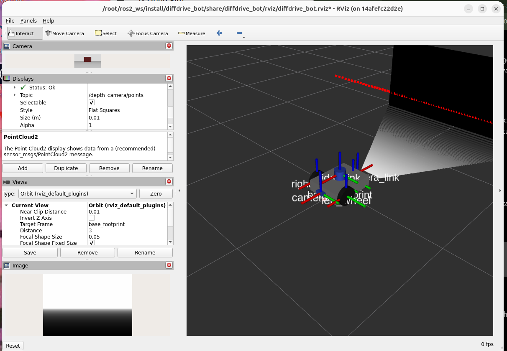
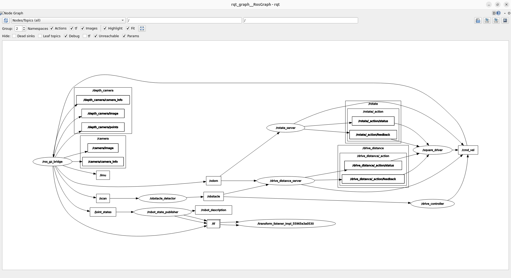

# Introduction to Robotics and Intelligent Systems — Lab 1

## Overview

This project extends a differential-drive robot simulation using ROS 2 and Gazebo. It introduces additional robot sensors, obstacle avoidance, custom ROS 2 interfaces, services, actions, and square-path navigation.

The implementation was developed and tested using ROS 2 Humble.

## Packages

| Package | Description |
|---|---|
| `diffdrive_bot` | Robot description, Gazebo simulation, sensor configuration, and ROS-Gazebo communication |
| `lab_interfaces` | Obstacle information message, speed service, and drive-distance action |
| `my_robot_interfaces` | Custom robot status message, turn-speed service, and rotation action |
| `my_robot_nodes` | Python nodes for obstacle avoidance, rotation, and square navigation |

## Build

From the ROS 2 workspace:

```bash
source /opt/ros/humble/setup.bash
cd ~/ros2_ws
colcon build --symlink-install
source install/setup.bash
```

## Implementation

### 1. Depth Camera and IMU

The robot description was extended with a depth camera and an IMU.

**Depth camera configuration:**
- Resolution: 320 × 240
- Update rate: 10 Hz
- Horizontal field of view: 1.047 radians
- Clipping range: 0.1–10 m

**IMU configuration:**
- Configured update rate: 50 Hz

The ROS-Gazebo bridge makes the following sensor data available:

| Topic | ROS message type |
|---|---|
| `/depth_camera/image` | `sensor_msgs/msg/Image` |
| `/depth_camera/points` | `sensor_msgs/msg/PointCloud2` |
| `/depth_camera/camera_info` | `sensor_msgs/msg/CameraInfo` |
| `/imu` | `sensor_msgs/msg/Imu` |

The depth image and point cloud were inspected in RViz.

### 2. Obstacle Avoidance

The `turn_away` node subscribes to obstacle information on `/obstacle` and publishes velocity commands to `/cmd_vel`.

When no obstacle is too close, the robot moves forward. When an obstacle is detected within the defined threshold, the robot stops and turns away.

The node provides configurable ROS 2 parameters:
- `forward_speed`
- `turn_speed`

It also publishes robot state information through the custom `/robot_status` topic.

### 3. Custom Message and Services

The `RobotStatus` message reports the robot's current state and obstacle distance.

Two services are provided:

- `/turn_away_enable` — enables or disables obstacle avoidance.
- `/set_turn_speed` — changes the turning speed and validates the requested value.

Example service calls:

```bash
ros2 service call /turn_away_enable std_srvs/srv/SetBool "{data: true}"

ros2 service call /set_turn_speed my_robot_interfaces/srv/SetTurnSpeed "{turn_speed: 1.0}"
```

### 4. Rotation Action

A custom `Rotate` action was implemented to control the robot's rotation.

The rotation server uses odometry to track angular movement and provides feedback while executing a goal.

Example goal:

```bash
ros2 action send_goal --feedback /rotate my_robot_interfaces/action/Rotate "{angle: 1.57}"
```

### 5. Square Navigation

The square driver uses the drive-distance and rotation actions to navigate a square path. The side length can be configured when launching the exercise.

Example:

```bash
ros2 launch my_robot_nodes square.launch.py side_length:=0.8
```

The square navigation test completed successfully.

## Performance and Issues

### IMU Update Frequency

Although the IMU was configured at 50 Hz, `ros2 topic hz /imu` measured approximately 12 Hz during testing.

The Gazebo simulation was running slower than real time during this measurement. The configured sensor update rate was retained at 50 Hz.

### Graphics Rendering

Gazebo encountered Intel graphics rendering issues in the container. Enabling software rendering resolved the problem:

```bash
export LIBGL_ALWAYS_SOFTWARE=1
```

### Launch Sequencing

The square driver initially attempted to send a goal before the drive-distance action server was ready. The launch sequence was adjusted to wait for odometry and allow the required startup time. Square navigation then completed successfully.

## Screenshots

### RViz — Depth Camera and Point Cloud



### rqt_graph — ROS Computation Graph


